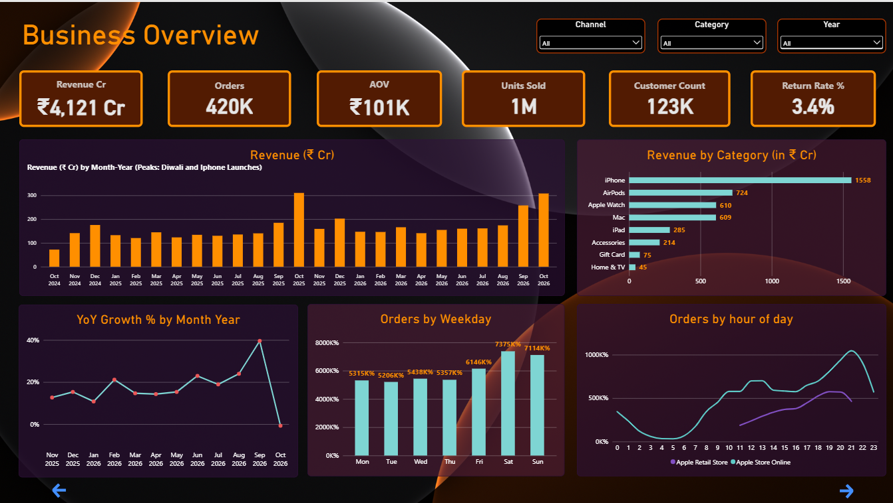
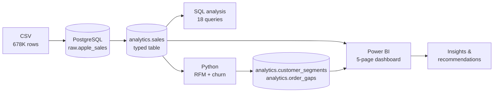
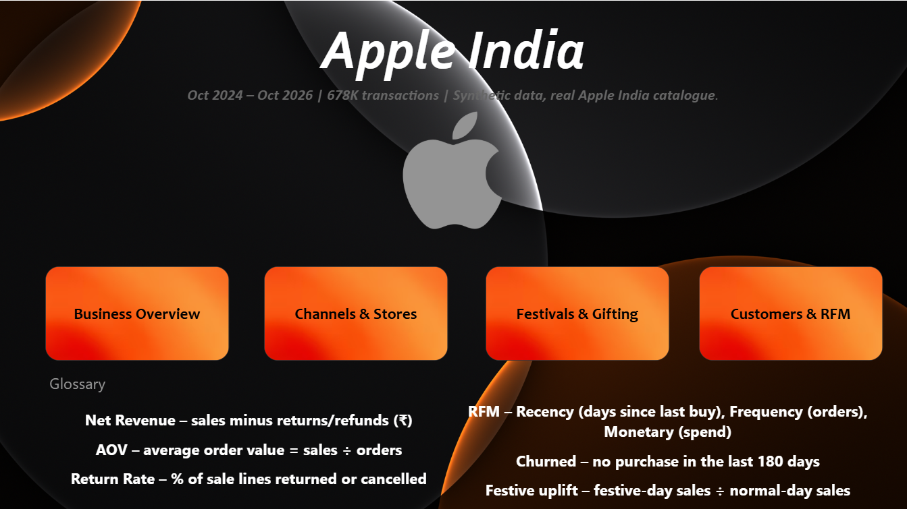
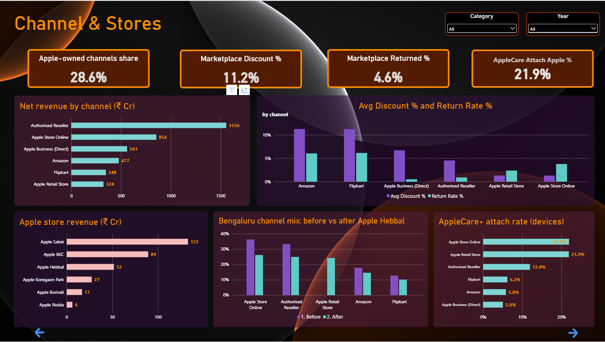
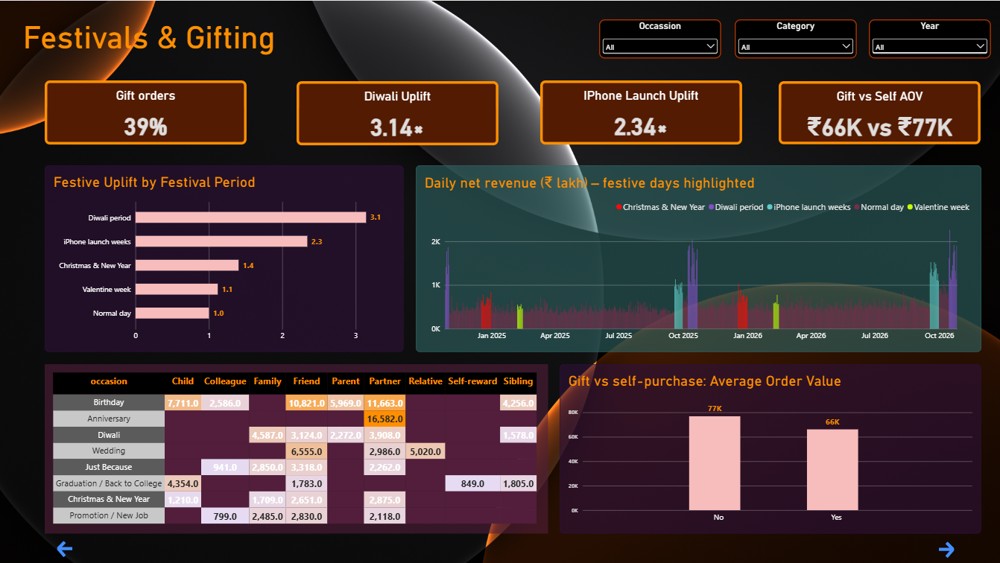
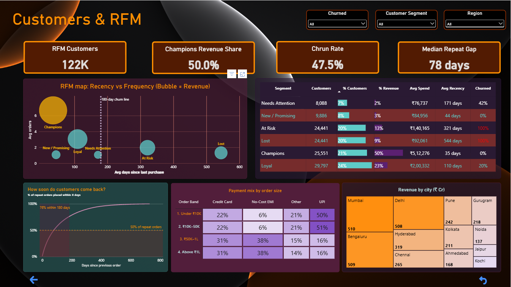

# Apple India: Customer, Channel & Festive Gifting Analytics

*An end-to-end data analytics project using **PostgreSQL**, **Python** and **Power BI***

### 🔗 [View the live interactive dashboard](https://app.powerbi.com/view?r=eyJrIjoiMWVkYmE5OWQtMmM0My00ODJkLTg3YTAtMzY2ZGQxNTExNDcyIiwidCI6ImQxZjE0MzQ4LWYxYjUtNGEwOS1hYzk5LTdlYmYyMTNjYmM4MSIsImMiOjEwfQ%3D%3D)

**Author:** Vedant Gangrade · [Kaggle dataset](https://www.kaggle.com/datasets/vedantgangrade/apple-india-gifting-and-sales-transactions-2024-26)



---

## ⚠️ Disclaimer

This is an **independent educational project**, not affiliated with or endorsed by Apple Inc.
The **product catalogue is real** (Apple India products, launch dates, approximate MRPs and price changes, Apple store openings). The **customers, orders and revenue are synthetic**, so the findings demonstrate the analysis method, not Apple's actual business performance.

---

## 📌 Project Overview

This project simulates a real analytics engagement for **Apple India**: taking 678K raw transactions through **SQL analysis**, **Python customer segmentation** and an **interactive Power BI dashboard**, ending with business recommendations.

It follows the workflow an analyst would use inside a company:
**define the business questions → model and analyse in SQL → segment customers in Python → deliver insights in Power BI.**

## 🎯 Business Problem

Leadership wants to understand **what drives revenue, who the most valuable customers are, and how festivals, sales channels and gifting shape sales**, so they can plan festive campaigns, improve customer retention and choose the right channels.

### Business questions answered
1. How big is the business, and how is it trending month by month?
2. Which products and categories drive revenue vs volume?
3. How do sales channels compare on revenue, discounts, returns and AppleCare+?
4. Does opening a new Apple store change how a city buys?
5. How much do Diwali and iPhone launches lift sales?
6. Who gifts what, to whom, and how do gift orders differ?
7. Who are the most valuable customers (RFM), and who is churning?
8. How do Indian customers pay at different price points?
9. Which cities and regions matter most?

---

## 🗂️ Dataset

| | |
|---|---|
| **Source** | [Apple India Gifting & Sales Transactions (Kaggle)](https://www.kaggle.com/datasets/vedantgangrade/apple-india-gifting-and-sales-transactions-2024-26), created for this project |
| **Size** | 678,647 transaction lines · 48 columns · ~250 MB |
| **Period** | 27 Oct 2024 – 26 Oct 2026 |
| **Coverage** | 439,484 invoices · 123,443 customers · 57 product families · 40 cities · 6 sales channels |
| **Real elements** | Product names, configurations, colours, India launch dates, MRPs and price changes, Apple store opening dates, Indian festival calendar |
| **Synthetic elements** | Customers, orders, quantities, discounts, payments, ratings, returns |

> The full CSV is too large for GitHub (100 MB limit). Download it from Kaggle.

---

## 🛠️ Tools & Tech Stack

| Tool | Used for |
|---|---|
| **PostgreSQL + pgAdmin** | Loading raw data, type conversion, and 18 business analysis queries |
| **Python (pandas, SQLAlchemy, matplotlib)** in **Jupyter** | RFM scoring, customer segmentation, churn flag, repeat-purchase analysis, writing results back to PostgreSQL |
| **Power BI Desktop + DAX** | Data model, 40+ measures, and a 5-page interactive dashboard |

---

## 🔄 Workflow



### Step 1: PostgreSQL
- Loaded the CSV into a **raw** schema (all `TEXT`), then built an **analytics.sales** table with proper data types (timestamps, dates, numerics) and indexes.
- Wrote **18 business queries** across 7 themes using CTEs, window functions (`LAG`, `RANK`, `NTILE`), `FILTER`, `PERCENTILE_CONT` and date functions.

### Step 2: Python
- Pulled sale rows from PostgreSQL into pandas.
- Calculated **Recency, Frequency, Monetary** per customer and scored each 1–5 with quantiles.
- Assigned **6 segments**: Champions, Loyal, New / Promising, Needs Attention, At Risk, Lost.
- Justified a **180-day churn rule from the data** (75% of repeat purchases happen within ~177 days), instead of assuming one.
- Wrote `customer_segments` (122,204 customers) and `order_gaps` (238,371 repeat orders) back to PostgreSQL for Power BI.

### Step 3: Power BI
- **Star-style model:** `Calendar` → `Sales` ← `Customers` → `Order Gaps`.
- A DAX **calendar table**, time intelligence (YoY), a festival-period column, and 40+ measures.
- **5 interactive pages** with slicers, cross-filtering, drill-down, conditional formatting and dynamic reference lines.

---

## 🧮 SQL Analysis (18 questions)

| Theme | Questions |
|---|---|
| **Business overview** | Headline KPIs · monthly trend with MoM & YoY growth · busiest weekdays · hour of day (online vs store) |
| **Products** | Category share (revenue vs units) · top 3 products per category |
| **Channels & stores** | Channel comparison (revenue, discount %, return rate) · Apple store performance · Bengaluru before/after Apple Hebbal · AppleCare+ attach rate |
| **Festivals & gifting** | Festival uplift vs normal days · occasion × recipient · gift vs self-purchase |
| **Customers** | RFM segmentation · gap between repeat purchases · churn rate |
| **Payments** | Payment method by order size |
| **Geography** | Top 10 cities |

📄 Full queries: [`01_sql/apple_india_analysis.sql`](01_sql/apple_india_analysis.sql) · Result screenshots: [`01_sql/01_sql_results/`](01_sql/01_sql_results/)

---

## 📊 Power BI Dashboard

| Page | What it shows |
|---|---|
| **1. Home** | Navigation buttons and a glossary of terms |
| **2. Business Overview** | KPI cards, monthly revenue, YoY growth, category revenue, weekday and hour-of-day patterns |
| **3. Channels & Stores** | Channel revenue, discount vs return rate, Apple store revenue, Bengaluru store impact, AppleCare+ attach rate |
| **4. Festivals & Gifting** | Festival uplift, daily revenue with festive days highlighted, occasion × recipient heatmap, gift vs self-purchase |
| **5. Customers & RFM** | RFM bubble map, segment summary table, cumulative return curve, payment heatmap, city treemap |

🔗 [**Open the live dashboard**](https://app.powerbi.com/view?r=eyJrIjoiMWVkYmE5OWQtMmM0My00ODJkLTg3YTAtMzY2ZGQxNTExNDcyIiwidCI6ImQxZjE0MzQ4LWYxYjUtNGEwOS1hYzk5LTdlYmYyMTNjYmM4MSIsImMiOjEwfQ%3D%3D) (no sign-in needed) · 📄 [Download the dashboard as PDF](reports/powerbi_appleindia_dashboard.pdf) · 📁 [`.pbix` file](03_powerbi/apple_india_dashboard_final.pbix)

<details>
<summary><b>📸 Click to view all dashboard pages</b></summary>







</details>

---

## 💡 Key Findings & Recommendations

| # | Finding | Recommendation |
|---|---|---|
| 1 | **Festivals drive the business.** Diwali days sell **3.1×** a normal day, and iPhone launch weeks **2.3×**. Oct 2025 alone brought ₹310 Cr, about double a typical month | Plan stock, staffing and bank offers around these windows, and start Diwali campaigns 2–3 weeks earlier |
| 2 | **A small group brings half the revenue.** Champions are **21% of customers but 50% of revenue**, averaging ₹5.1 lakh spend and ~6.7 orders | Protect them with early launch access, priority service and exclusive offers |
| 3 | **Nearly half of customers have gone quiet.** Median repeat gap is **78 days**, 76% of repeat purchases happen within 180 days, and **47.5% of customers have churned**, including 24,441 At Risk customers averaging ₹1.4 lakh spend | Run win-back campaigns at 120–150 days of inactivity, before customers cross the 180-day line |
| 4 | **Marketplaces sell volume at a cost.** Amazon and Flipkart give **~11% discount** with **~4.6% returns**, vs ~1.3% and ~2.3% on Apple channels. AppleCare+ attach is **~6% vs ~22%** | Steer buyers to Apple-owned channels with bundles, trade-ins and AppleCare+ offers, and use marketplaces mainly for Tier-2/3 reach |
| 5 | **New stores win share fast.** Apple Hebbal took **~24% of Bengaluru's retail revenue** in its first year, mostly from Apple Online and resellers | Judge new stores on total city revenue, since they shift demand as well as create it |
| 6 | **Payment depends on price.** **UPI ~50%** of orders under ₹50K, while **No-Cost EMI is #1 above ₹50K (~38%)** | Keep EMI prominent for iPhone and Mac, and optimise UPI checkout for accessories |
| 7 | **Gifting is a major use case.** **~39% of retail orders are gifts**, ~14% smaller than self-purchases, with no higher return rate. Anniversary → Partner is the top combination | Run occasion-led campaigns, and promote engraving and gift messages online |
| 8 | **iPhone leads revenue, accessories lead volume.** iPhone ≈ 38% of revenue. Mumbai, Bengaluru and Delhi each bring ~₹510 Cr | Bundle accessories at iPhone checkout, and focus metro marketing on the top 3 cities |
| 9 | **Timing.** Stores peak 6–8 pm, online 9–10 pm. Weekends have the most orders, while weekdays bring more revenue (corporate) | Add evening store staff, and send campaigns in the late evening |

📄 Full write-up: [`reports/Insights_and_Recommendations.pdf`](reports/Insights_and_Recommendations.pdf)

---

## 🧠 Concepts Demonstrated

- **RFM analysis & customer segmentation**, with quantile scoring and rule-based segments
- **A data-driven churn definition** from the distribution of repeat-purchase gaps
- **SQL:** CTEs, window functions (`LAG`, `RANK`, `NTILE`), `FILTER`, percentiles, date logic, before/after comparisons
- **Python ↔ database integration:** reading from and writing back to PostgreSQL with SQLAlchemy
- **Power BI modelling:** star-style relationships, a calendar table, time intelligence, `CALCULATE`/`FILTER`/`KEEPFILTERS`/`REMOVEFILTERS`
- **Interactive BI design:** slicers, cross-filtering, drill-down, conditional formatting, dynamic constant lines, page navigation

---

## 📁 Repository Structure

```
├── README.md
├── 01_sql/
│   ├── apple_india_analysis.sql        # setup + 18 analysis queries
│   └── 01_sql_results/                 # screenshots of each query result
├── 02_python/
│   └── RFM_ANALYSIS.ipynb              # RFM, segments, churn, order gaps
├── 03_powerbi/
│   └── apple_india_dashboard_final.pbix  # 5-page dashboard
├── data/
│   └── customer_segments.csv           # Python output (full data on Kaggle)
├── images/                             # Python charts + dashboard screenshots
└── reports/
    ├── powerbi_appleindia_dashboard.pdf
    └── Insights_and_Recommendations.pdf
```

---

## ▶️ How to Reproduce

1. **Download the data** from [Kaggle](https://www.kaggle.com/datasets/vedantgangrade/apple-india-gifting-and-sales-transactions-2024-26).
2. **PostgreSQL:** create a database (e.g. `appleindia_clean`), run the setup part of `01_sql/apple_india_analysis.sql`, import the CSV into `raw.apple_sales` (pgAdmin → Import/Export, CSV, UTF-8, header on), then build `analytics.sales` and run the analysis queries.
3. **Python:** open `02_python/RFM_ANALYSIS.ipynb`, set your database password in the connection cell, then run all cells. This creates `analytics.customer_segments` and `analytics.order_gaps`.
4. **Power BI:** open `03_powerbi/apple_india_dashboard_final.pbix` → **Transform data → Data source settings** → point it to your PostgreSQL database → **Refresh**.

**Requirements:** PostgreSQL 14+, Python 3.10+ (`pandas`, `numpy`, `matplotlib`, `sqlalchemy`, `psycopg2-binary`), Power BI Desktop.

---

## ⚠️ Limitations

- Transactions are **synthetic**, so the findings illustrate the method, not Apple's real performance.
- Some relationships aren't present in the data (e.g. demographics don't influence spend, and add-on products aren't linked to the main purchase), so they weren't analysed.
- **Oct 2024 is a partial month** (data starts 27 Oct), and **Diwali 2026 (8 Nov) falls after the data ends**, so Oct 2026 shows only the pre-festival run-up.
- Simple before/after comparisons (e.g. the Sept 2026 price changes) are affected by seasonality, so causal claims are avoided.

---

## 🙏 Acknowledgements

- Workflow inspired by the *IKEA Gifting* SQL + Python + Power BI tutorial by Mansi Goel.
- Transaction structure modelled on the [UCI Online Retail II](https://archive.ics.uci.edu/dataset/502/online+retail+ii) dataset.
- Apple product, price and store information compiled from public news sources and Apple Newsroom (see the Kaggle dataset page for the full source list).

---

⭐ If you found this project useful, consider giving the repo a star!
